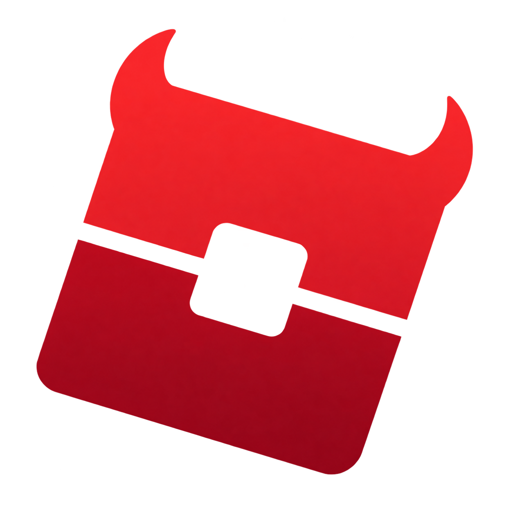

<p align="center">
  
</p>

<h1 align="center">Intoxicated</h1>

<p align="center">
  <strong>Roblox on FreeBSD. 100% native.</strong><br>
  No linuxulator. No emulator. No Wine. No Waydroid. Nothing under <code>/compat/linux</code>.<br>
  The official Roblox engine running as a real FreeBSD process.
</p>

<p align="center">
  Bugs and feature requests go on
  <a href="https://github.com/neoppix/intoxicated/issues">this repo's issues</a>.
</p>

<p align="center"><em>A hobby project, not a commercial one. Please don't DMCA it.</em></p>

## What it is

Intoxicated loads Roblox's official **Android x86-64** engine directly on FreeBSD
through its own runtime: the AOSP bionic linker, a bionic-to-FreeBSD libc shim, a
JNI VM (libjnivm) in place of Android's, and a framework layer that answers the
engine's calls into Android.

**It runs native, all the way down.** The `intoxicated-run` binary is a native
FreeBSD ELF, not a linuxulator program. The graphics go through native FreeBSD
Vulkan or GLES2. The input goes through native X11. And `libroblox.so` itself, the
Linux/Android engine, is loaded and executed by the AOSP bionic linker as
native FreeBSD code, with FreeBSD-specific shims wherever the two ABIs disagree
(syscalls, `pthread`, `environ`, `/proc`, futexes). Nothing emulates Roblox and
nothing runs it under the Linux ABI. It talks to your GPU the way any native app
does.

The headline port work: Roblox's anticheat kicks for **reason 304** on FreeBSD,
because `libroblox.so` makes raw kernel-ABI syscalls the bionic setup can't route
cleanly. Intoxicated patches every raw syscall site in the engine to `ud2` (16 in
Roblox 2.748.1527; the sites are found automatically at load by disassembling the
library, and cached per build in `~/.cache/intoxicated/syscall-sites/`) and catches
the resulting `SIGILL`, routing each through `bionic_syscall`, so the anticheat
stops seeing the thing it was killing the client for. That fix is what makes any
of the rest matter.

## Get it running

This is a **build-from-source hobby port** on FreeBSD, tested on FreeBSD
14.4-RELEASE with an NVIDIA GPU (RTX 40-series), native X11, and native Vulkan.

**Zero `/compat/linux` at runtime.** The engine reads Linux `/proc` and `/sys`;
every one of those reads (`meminfo`, `cpuinfo`, the process list the anticheat
scans, `self/{fd,auxv,status,maps}`, and the rest) is answered from FreeBSD's own
`sysctl`/`elf_aux_info`, not from linprocfs. There is no linuxulator and no
Linux-compat filesystem mount to set up. Verified with `ktrace` over a full
session (sign-in, join, deploy, play): **0** of 52,352 path lookups were under
`/compat/linux`.

**Quick install.** Paste this into a terminal, as your own user:

```sh
fetch -qo - https://raw.githubusercontent.com/neoppix/intoxicated/freebsd-port/install.sh | sh
```

It checks what the system is missing (packages, the GPU driver and its kernel
module), lists the commands that need root and asks before running them, with
the password going to sudo, doas or su. Then it clones the checkout to
`~/intoxicated` (`INTOXICATED_REPO` picks another place), builds it, installs
the launcher and the desktop entry, offers
[Intoxicated Settings](#intoxicated-settings) and to open roblox.com's Play
button in Intoxicated, and fetches the Roblox build. Running it again, or
`intoxicated --update`, updates an install. It does what the steps below do,
which stay here for anyone who would rather do them by hand.

**1. Prerequisites** (as root):

```sh
# Build tools, native X11, native Vulkan loader, epoll for the engine's event
# loop, and jq (the launcher edits flags.json)
pkg install git rust cmake pkgconf libepoll-shim libX11 libXi libXinerama libXrandr libxkbcommon vulkan-loader jq

# Audio needs no packages: the client writes to OSS (/dev/dsp) directly, and
# sound(4) is part of base. It plays to /dev/dsp, which follows
# hw.snd.default_unit; set INTOXICATED_AUDIO_DEVICE=/dev/dspN to pick another.

# Native GPU driver (this is what provides the real Vulkan ICD)
pkg install nvidia-driver          # NVIDIA; use the Mesa drivers for AMD/Intel
sysrc kld_list+="nvidia-modeset" && kldload nvidia-modeset
```

You also need a running X11 session. That is the whole list, no linuxulator.

**2. Build:**

```sh
git clone --recursive https://github.com/neoppix/intoxicated ~/intoxicated
cd ~/intoxicated
cargo build -p intoxicated-runtime --release
# produces target/release/intoxicated-run, a native FreeBSD binary
```

**3. Install the launcher** (as root):

```sh
install -m 755 packaging/freebsd/intoxicated /usr/local/bin/intoxicated
```

It expects the checkout at `~/intoxicated`; set `INTOXICATED_REPO` if yours is
elsewhere.

**4. Run:**

```sh
intoxicated              # home page
intoxicated <placeId>    # straight into a game
intoxicated '<link>'     # a roblox:// link, roblox.com's Play link, or a
                         # https://www.roblox.com/games/<id> page link
intoxicated --update-apk # fetch the newest Roblox build, then exit
intoxicated --update     # update Intoxicated itself (pull, build, reinstall)
intoxicated --default-flags  # print the flags the client sets itself (JSON)
intoxicated --version    # print the client's version line
INTOXICATED_PROFILE=alt intoxicated   # run another profile (see below)
```

To update Intoxicated itself, run `intoxicated --update` (the installer, from
the checkout), or by hand pull and rebuild, then install the launcher again as
in step 3:

```sh
cd ~/intoxicated
git pull --recurse-submodules
cargo build --release    # the client and the APK fetcher
```

The git history was restarted on 2026-11-23, so a clone made before then
cannot pull. The installer notices, offers to move it aside and clones again;
by hand, do the same. The profile and the downloaded Roblox build live outside
the checkout and are kept.

**5. Optional: open roblox.com's Play button in Intoxicated** (the browser asks
for a handler for `roblox-player` links):

```sh
# as root
install -m 644 packaging/freebsd/intoxicated.desktop /usr/local/share/applications/
install -m 644 packaging/branding/intoxicated-logo.png /usr/local/share/pixmaps/intoxicated.png
update-desktop-database /usr/local/share/applications
# as your user
xdg-mime default intoxicated.desktop x-scheme-handler/roblox-player x-scheme-handler/roblox
```

A join link is turned into `roblox://experiences/start?placeId=<id>`, plus the
server or private-server code it names, and handed to the engine once the home
page is up. roblox.com's Play link carries a one-time sign-in ticket; it is
dropped, never passed to the engine and never printed, and the launcher runs
itself again with the rewritten link so the ticket does not stay in its
arguments. A link that names no place, is to another site, or carries a
malformed server id or code is refused (exit 2) and nothing of it reaches the
engine. The launcher sets `INTOXICATED_DEEPLINK_RETRY=1`, which re-publishes a
link nothing answered (once a second, at most 40 times) and stops at the first
`Game.launch`. For testing: `INTOXICATED_DEEPLINK_NO_PUBLISH=1` holds the link
without publishing it (the client stays on the home page),
`INTOXICATED_DEEPLINK_PROBE=1` lets devctl's `bussub` print payloads, and
`INTOXICATED_WEBVIEW_TEST=<url>` publishes one synthetic `openWindow`.

Intoxicated does **not** ship Roblox and never will. When no build is present the
launcher fetches the official Android x86-64 build (about 240 MB) from APKPure, a
third-party mirror, and **refuses anything not signed by Roblox's own
certificate**, so a tampered download is caught rather than trusted. It keeps it
in `~/.cache/intoxicated/apk` and fetches it again if that is ever cleared.

Your sign-in, settings and Roblox's own storage live in the profile,
`~/.local/share/intoxicated/profiles/default`. `INTOXICATED_PROFILE=<name>`
(1 to 32 letters, digits, `-` and `_`) runs another one, in
`profiles/<name>`, with its own account, storage and `flags.json`; one client
runs per profile, so two profiles can play at the same time.

The launcher also reads `~/.config/intoxicated/settings.conf`
(`$XDG_CONFIG_HOME`): one `INTOXICATED_*=value` line per switch, exported
unless that variable is already set in the environment, which wins. The value
is taken literally and the file is never run as shell; other lines are
ignored.

As on Android, the engine is told this machine's IPv4 addresses when it asks
(`NetworkUtils.getPublicIPv4Addresseses`): every interface but loopback, so a
LAN address too. Nothing is sent to find them.

Roblox's assets are read straight out of the APK. The only one written to disk is
the CA bundle, in `~/.cache/intoxicated/assets`.

The engine looks for Android system fonts under `/system/fonts`; the client
answers from `~/.cache/intoxicated/system`, a tree of links to the fonts in
`/usr/local/share/fonts`, `~/.local/share/fonts` and `~/.fonts`.

The launcher also keeps two flags in your profile's `flags.json`, adding each
only if it is missing so a value you set by hand wins:

- `DFIntTaskSchedulerTargetFps=9999` lifts Roblox's 60 fps Android cap.
  `INTOXICATED_FPS=<n>` picks another value, `INTOXICATED_FPS=off` skips it.
- `FIntRenderForceVideoMemorySize` raises the Android build's fixed 64 MB video
  memory budget to 1.5 GiB. `INTOXICATED_VIDEO_MEMORY=<bytes>` or `=off`.

The client itself turns off memory savers that Roblox's servers hand the
Android build for phones: `FFlagRenderShadowResolutionScaling`, which shrinks
the shadows of lights to as little as 114 pixels and keeps rebuilding them,
and the Vulkan allocator settings that pool only small allocations and free
every empty page at once (`FFlagVulkanAllocatorPoolSmallOnly`,
`FIntVulkanAllocatorKeepEmptyPages`, `FFlagVulkanAllocatorEmptyPageBudget`).
The allocator ones cost a few hundred MB more VRAM. A value for any of these
keys in `flags.json` overrides the client's.

`target/release/intoxicated-run --help` lists the client's options and
environment switches. Among them, `INTOXICATED_RESOLUTION=<w>x<h>` sets the
render size (1280x720 by default; a fullscreen monitor overrides it) and
`INTOXICATED_FILES_DIR=<dir>` moves Roblox's data out of the profile. The
client no longer runs `nvidia-settings` to force NVIDIA's PowerMizer to maximum
performance (the setting did not hold on FreeBSD's driver and cost about 0.1 s
of every start), so `INTOXICATED_GPU_MAXPERF` is gone, and the early client
settings are always sent, so `INTOXICATED_EARLY_SETTINGS` is no longer needed.

When the disk holding the profile's Roblox data runs short, the client says so:
below 2 GiB free as it hands Roblox its window, below 512 MiB again when the
run ends. The engine itself never reports a full disk.

A new Roblox build can import symbols Intoxicated does not answer yet; if
`intoxicated` reports `cannot locate symbol`, that is what happened. The raw
syscall sites the anticheat fix needs are found automatically for every build.

## Intoxicated Settings

An optional desktop app for what is otherwise set by hand. FastFlags: presets
(frame rate cap, video memory budget, light shadows, GPU memory pooling, 4x
MSAA), every flag in the profile's `flags.json` with inline editing, import of
a JSON file (a Bloxstrap export or a `ClientAppSettings.json`) with a preview,
export and reset. Client options: window, input, graphics, audio and session.
Profiles: create, delete and pick the default one. And Play, a place id or
link field, and the two update commands. It is a Qt 6 Widgets program in
`settings/` that needs `qt6-base` and nothing else.

The installer asks whether to install it (the answer defaults to yes) while it
checks the packages, so Qt is installed with the rest; it builds the app as
your user and installs it with the launcher. Once it is installed, every later
run updates it without asking, and a failed build of the app does not stop the
rest of the install. By hand:

```sh
pkg install qt6-base                     # as root
cmake -S settings -B settings/build -DCMAKE_BUILD_TYPE=Release
cmake --build settings/build -j "$(sysctl -n hw.ncpu)"
# as root
install -m 755 settings/build/intoxicated-settings /usr/local/bin/
install -m 644 packaging/freebsd/intoxicated-settings.desktop /usr/local/share/applications/
```

It writes two kinds of file, and both can still be edited by hand:

- `~/.config/intoxicated/settings.conf`: the client options, read by the
  launcher as above. A control at its default removes its line; lines the app
  does not manage, comments included, are kept.
- `~/.local/share/intoxicated/profiles/<profile>/flags.json`: the profile's
  flags, one JSON object. A file that is not a JSON object is never written
  over; the app offers to keep it as `flags.json.bad-<time>` and start empty.

Both are written to a temporary file and renamed into place. The presets show
the client's own flags, which the app reads from `intoxicated --default-flags`.
A profile shows as in use while a client holds it, and is not deleted then.
"Update Intoxicated" runs `intoxicated --update` with no terminal, so the
installer asks for the password through the app's own dialog (`sudo -A` with
`SUDO_ASKPASS`). `ctest --test-dir settings/build` runs the app's self-test
of its file handling, against scratch directories.

## Status: early, but it plays

Reason-304 is solved, so the client stays in the game. Sign-in, loading a game,
moving around, mouse and keyboard (including shift-lock, Ctrl+A/C/X/V and real
clipboard), uncapped framerate, held-key input, and audio all work. Keys reach
the game by their position on any keyboard layout, with any modifiers held
(sprint plus a number key, Shift+Tab, the keypad), and chat takes accented
letters and dead keys. Meshes load at
full detail, and on NVIDIA, whose Vulkan driver has no ETC2 textures, Intoxicated
decodes them itself so the textures the engine would otherwise drop are drawn.

The ETC2 decode runs across several cores (a 50 MB burst while a map loads
decodes in about 60 ms), and the memory it decodes into is reused rather than
allocated again for every frame, which on NVIDIA is a slow kernel call. In
Frontlines, the seconds after deploying used to bring 15 to 18 frames of 100
to 800 ms and once a 3.3 s freeze; now 3 to 6 frames of up to about 150 ms,
and 2.5 minutes in game afterwards had 9 frames over 40 ms, none over 250 ms.
`intoxicated <placeId>` joins the place directly.
Game audio goes straight to OSS with about 10 ms of device latency, so it works
without PulseAudio and sounds land in time with what is on screen.
Keys reach the game by their physical position, so Shift plus a number switches
weapons while sprinting and non-US layouts work, and mouse motion always
arrives before the click that follows it, so a flick and a shot land in order.

Known problems:

- Sun shadows use the 1024-pixel shadow maps the Android build picks and look
  blocky in the distance; no setting that raises them has been found yet.
- Joining a server still stalls for about 2 s in all while the map loads,
  most of it the engine's own work.
- About every 45 s the engine's own periodic work holds one frame for about
  100 to 130 ms.
- Now and then, once in a match, a frame freezes for up to about 3 s shortly
  after deploying or at the first death; the cause is not found yet.
- Voice chat is unimplemented. Game controllers are not supported yet: the old
  support read Linux-only joystick paths and never found a device on FreeBSD,
  so it was removed; native FreeBSD (evdev) support is still to be written.

## License

Licensed **GPL-3.0-or-later**, see [`LICENSE`](LICENSE). The build links two
MIT-licensed projects, ChristopherHX and MCMrARM's
[mcpelauncher-linker](https://github.com/minecraft-linux/mcpelauncher-linker)
(the AOSP bionic linker port) and ChristopherHX's
[libjnivm](https://github.com/ChristopherHX/libjnivm); their notices are in
[`NOTICE`](NOTICE) and [`THIRD-PARTY-NOTICES.md`](THIRD-PARTY-NOTICES.md). Roblox and the Roblox engine
are the property of Roblox Corporation and are not redistributed here.
